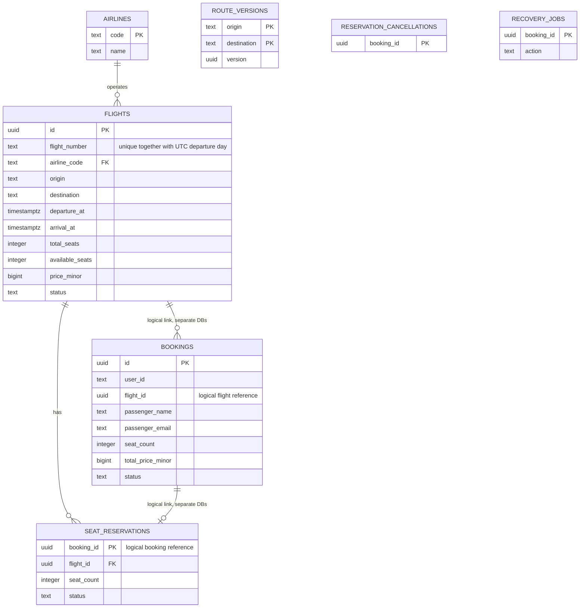

# Устройство системы

`AIRLINES`, `FLIGHTS`, `SEAT_RESERVATIONS`, `ROUTE_VERSIONS` и `RESERVATION_CANCELLATIONS` принадлежат Flight DB. `BOOKINGS` и `RECOVERY_JOBS` принадлежат Booking DB. Межсервисные связи логические: внешних ключей между двумя БД нет. У успешного бронирования ровно одна резервация; после отмены она сохраняется со статусом RELEASED. Неуспешная попытка может оставить освобождённую резервацию без бронирования.

## 3NF и ограничения

Название авиакомпании вынесено в справочник. Данные рейса не копируются в бронирование, а имя и email относятся к пассажиру конкретного заказа. `user_id` обозначает заказчика и не определяет пассажира. `total_price_minor` — исторический снимок, а не производное от текущей цены рейса. Номер рейса вместе с UTC-днём вылета уникален. В служебных таблицах все неключевые поля зависят только от полного первичного ключа.

SQL проверяет положительные цену, общее число мест и размер резервации, границы доступных мест, время прилёта после вылета, IATA-коды, разные аэропорты и допустимые статусы. Индекс поиска покрывает маршрут и время для SCHEDULED, отдельный индекс ускоряет список бронирований пользователя.

## Транзакции и восстановление

Flight сериализует операции одного booking_id транзакционной advisory-блокировкой. Затем `SELECT FOR UPDATE` блокирует рейс, проверяются статус и остаток. Уменьшение остатка и создание резервации коммитятся вместе. Повтор с теми же параметрами возвращает активную резервацию; другие параметры дают ALREADY_EXISTS. Освобождённый резерв нельзя активировать повторно.

При отмене блокируются резервация и рейс, возврат мест и RELEASED записываются одной транзакцией. Если резервации ещё нет, в `RESERVATION_CANCELLATIONS` сохраняется booking_id и возвращается NOT_FOUND. Это запрещает запоздавшему ReserveSeats списать места после завершившейся компенсации.

Booking выполняет GetFlight → ReserveSeats → запись CONFIRMED. Перед ReserveSeats он сохраняет задание RELEASE в `RECOVERY_JOBS`. Сохранение бронирования и удаление задания происходят одной локальной транзакцией. Если RPC или запись бронирования не удались, фоновой обработчик освобождает резерв. Потеря ответа ReserveSeats не приводит к утечке мест.

Перед отменой сохраняется задание CANCEL. Обработчик вызывает идемпотентный ReleaseReservation, затем одной транзакцией меняет статус бронирования и удаляет задание. Если процесс остановился между этапами, отмена завершается после восстановления. Повторные попытки сохраняют исходный booking_id.

Сеансовая advisory-блокировка Booking DB защищает одну операцию от одновременной обработки HTTP-запросом и фоновым процессом, в том числе в разных экземплярах приложения. Соединение удерживается на время операции; для записи задания второе соединение не требуется. После разрыва соединения PostgreSQL освобождает блокировку. При ошибке снятия блокировки соединение удаляется из пула.

Это сага, а не распределённая ACID-транзакция: во время сбоя возможен временный резерв без бронирования или CONFIRMED после возврата мест. Незавершённые действия сохранены в БД и доводятся до конца при восстановлении зависимостей. Ошибка отмены не удаляет намерение: отмена может завершиться фоново, результат проверяется через GET. Потеря HTTP-ответа после коммита не отменяет успешную операцию; идемпотентность повторного POST клиента заданием не требуется.

## Кеш

Cache-aside: прочитать версию маршрута → проверить Redis → при miss прочитать рейсы из PostgreSQL и записать в Redis с TTL. Ключи:

- `flight:{id}:{version}`;
- `search:{origin}:{destination}:{date|all}:{version}`.

Триггер PostgreSQL меняет UUID версии маршрута в той же транзакции, что INSERT, UPDATE или DELETE рейса. ReserveSeats и ReleaseReservation тоже изменяют рейс и автоматически инвалидируют его данные и все поиски маршрута. Изменение маршрута инвалидирует обе стороны. Отдельного UpdateFlight в обязательном API нет; прямое изменение рейса также покрыто триггером.

Инвалидация логическая: старые ключи становятся недоступны новым чтениям и удаляются по TTL. Даже если запрос, начавшийся до мутации, позже заполнит старый ключ, новое чтение использует другую версию. Redis failover не может вернуть старую версию в обращение: её источник — PostgreSQL. Цена этой гарантии — короткий индексный запрос версии к БД на cache hit и инвалидация всего маршрута при изменении одного рейса. Полные данные рейсов и результаты поиска на hit читаются из Redis. Пустые результаты также кешируются; при появлении первого рейса триггер создаёт новую версию маршрута.

Redis недоступен — приложение читает PostgreSQL; ожидание Redis ограничено короткими таймаутами. Sentinel-клиент отслеживает выбранный мастер. Все значения Redis имеют TTL, служебные версии находятся в PostgreSQL. В логах видны hit, miss и ошибки кеша.

## Контракт ошибок

| gRPC | Условие | HTTP |
| --- | --- | --- |
| INVALID_ARGUMENT | Неверный UUID, маршрут, дата, количество мест или JSON | 400 |
| NOT_FOUND | Нет рейса, бронирования или резервации | 404 |
| RESOURCE_EXHAUSTED | Недостаточно мест | 409 |
| FAILED_PRECONDITION | Рейс не SCHEDULED или резерв уже освобождён | 409 |
| ALREADY_EXISTS | booking_id повторён с другими параметрами | 409 |
| UNAUTHENTICATED | Отсутствующий или неверный x-api-key | 502 на REST, поскольку ошибка межсервисная |
| UNAVAILABLE | Недоступная БД/Flight либо открытый circuit breaker | 503 |
| DEADLINE_EXCEEDED | Истёк дедлайн | 504 |
| CANCELED | Отменён вызывающий контекст | 408 |

Ключ передаётся из окружения в metadata всех RPC и проверяется серверным interceptor. Секрет не выводится в логи. В учебной сети Compose используется plaintext gRPC; внешняя аутентификация REST не входит в задание.

## Соответствие заданию

| Пункт | Реализация |
| --- | --- |
| 1 | `api/flight/v1/flight.proto`: четыре бизнес-RPC, Timestamp и enum; `make generate` |
| 2 | ER-диаграмма выше и ограничения миграций |
| 3 | Два приложения, две PostgreSQL, автоматический golang-migrate, все REST-маршруты |
| 4 | Create: GetFlight → ReserveSeats → сохранение цены; Cancel: ReleaseReservation |
| 5 | SELECT FOR UPDATE, атомарные изменения мест и резерваций, долговечные компенсации |
| 6 | API key из окружения, client/server interceptors, UNAUTHENTICATED |
| 7 | Cache-aside, TTL 5–10 минут, версии при мутациях, hit/miss |
| 8 | До трёх попыток, exponential backoff, только UNAVAILABLE/DEADLINE_EXCEEDED, стабильный booking_id |
| 9 | Redis master, replica, три Sentinel, go-redis FailoverClient |
| 10 | Interceptor с CLOSED/OPEN/HALF_OPEN, настройками окружения и логами; HTTP 503 при OPEN |
