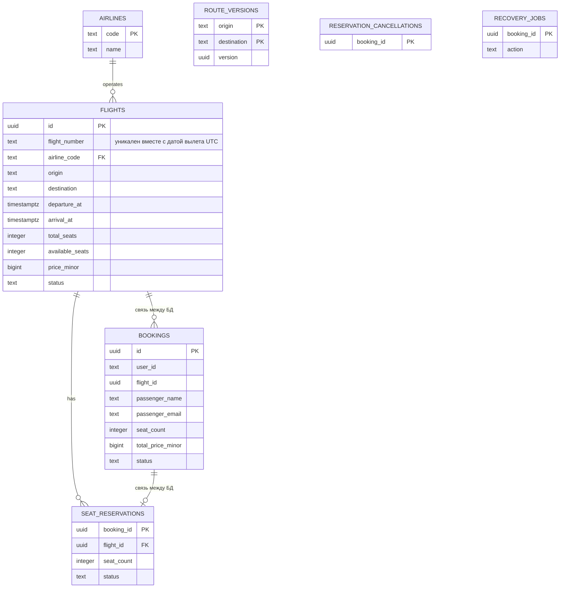

# Схема данных

Flight хранит рейсы и резервации. Booking хранит бронирования и задания на восстановление (`RECOVERY_JOBS`). У сервисов отдельные PostgreSQL, внешних ключей между ними нет.

Авиакомпании вынесены в справочник. Имя и email пассажира относятся к конкретному бронированию; `user_id` — заказчик. Стоимость фиксируется при покупке в копейках и не меняется вслед за ценой рейса. Даты учитываются в UTC.

Ограничения БД запрещают отрицательный остаток мест, нулевые цену и вместимость, прилёт раньше вылета. Номер рейса и дата вылета вместе уникальны.

## Бронирование

Booking получает рейс через `GetFlight`, вызывает `ReserveSeats`, затем сохраняет CONFIRMED. Flight блокирует рейс через `SELECT FOR UPDATE` и одной транзакцией списывает места и создаёт резервацию. Повтор с тем же `booking_id` и параметрами не списывает места ещё раз. Отмена одной транзакцией возвращает места и меняет статус резервации на RELEASED.

Перед резервированием Booking сохраняет задание RELEASE в `RECOVERY_JOBS`. При успехе задание удаляется вместе с записью бронирования в одной транзакции. При сбое фоновый обработчик освобождает места. Отмена работает так же, с заданием CANCEL. Advisory-блокировки по `booking_id` не дают запросу и обработчику восстановления выполнять одну операцию одновременно.

Если отмена пришла раньше резервирования, Flight запоминает `booking_id` в `RESERVATION_CANCELLATIONS` и отклоняет запоздавший резерв.

Общей транзакции между сервисами нет: после сбоя их состояние может временно расходиться. Сохранённые задания выполняются после восстановления связи. Поэтому отмена может завершиться даже после ошибки HTTP-запроса; её результат можно узнать через GET.

## Кеш

Flight читает версию маршрута из PostgreSQL и ищет ответ в Redis. При промахе загружает данные из БД и кеширует их на 5–10 минут.

Ключи: `flight:{id}:{version}` и `search:{origin}:{destination}:{date|all}:{version}`.

Триггер меняет версию маршрута при изменении рейса, в том числе при резервировании и возврате мест. Новые запросы больше не используют старые ключи; те удаляются по TTL. Это защищает и от запоздавшей записи старого ответа в кеш. Обратная сторона — запрос версии к PostgreSQL даже при попадании в кеш.

При недоступности Redis чтение идёт из PostgreSQL. Три Sentinel выбирают нового мастера из реплик, клиент переподключается автоматически.

## gRPC

Ключ из `GRPC_API_KEY` передаётся в metadata `x-api-key`. Flight проверяет его для каждого метода.

Booking повторяет только UNAVAILABLE и DEADLINE_EXCEEDED: максимум три попытки с паузами 100 и 200 мс. Circuit breaker после серии ошибок открывается и возвращает HTTP 503 без вызова Flight. После паузы пропускает один пробный запрос без повторов. Параметры задаются через окружение.

| Код | Причина | HTTP |
| --- | --- | --- |
| INVALID_ARGUMENT | Некорректные параметры | 400 |
| NOT_FOUND | Запись не найдена | 404 |
| RESOURCE_EXHAUSTED | Недостаточно мест | 409 |
| FAILED_PRECONDITION | Рейс не SCHEDULED или резерв уже освобождён | 409 |
| ALREADY_EXISTS | `booking_id` использован с другими параметрами | 409 |
| UNAUTHENTICATED | Неверный межсервисный ключ | 502 |
| UNAVAILABLE | Сервис или БД недоступны, breaker открыт | 503 |
| DEADLINE_EXCEEDED | Истёк дедлайн | 504 |
| CANCELED | Запрос отменён | 408 |
