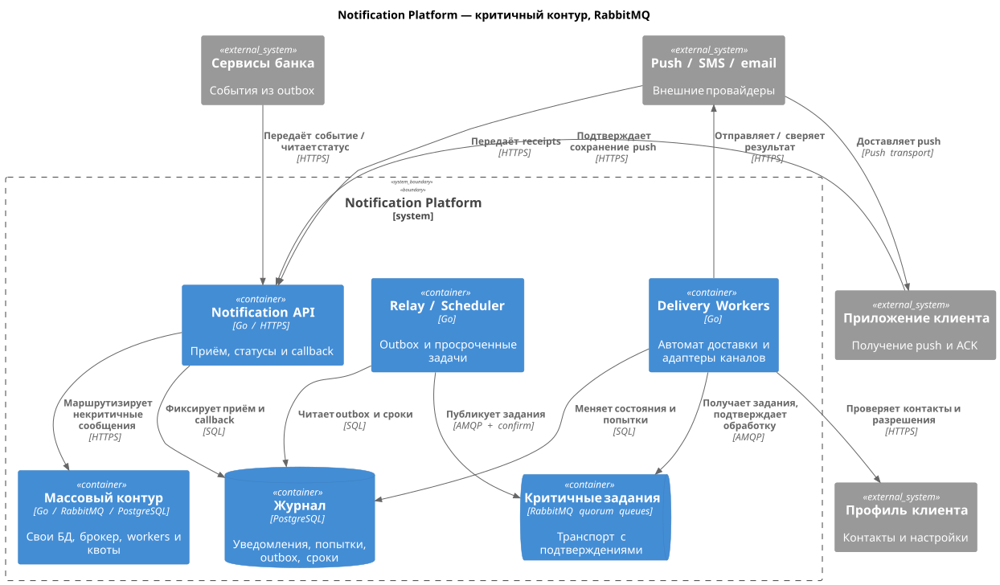
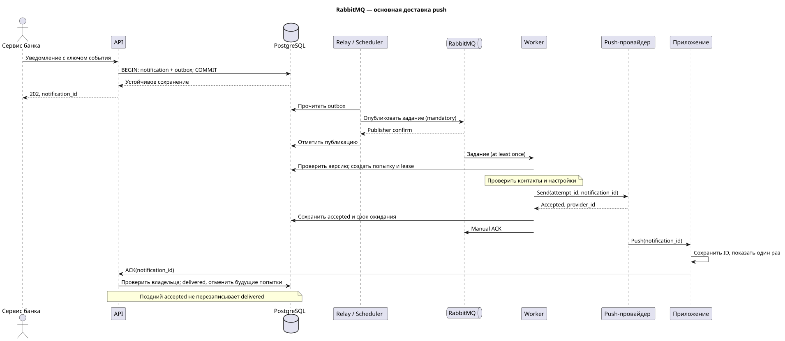
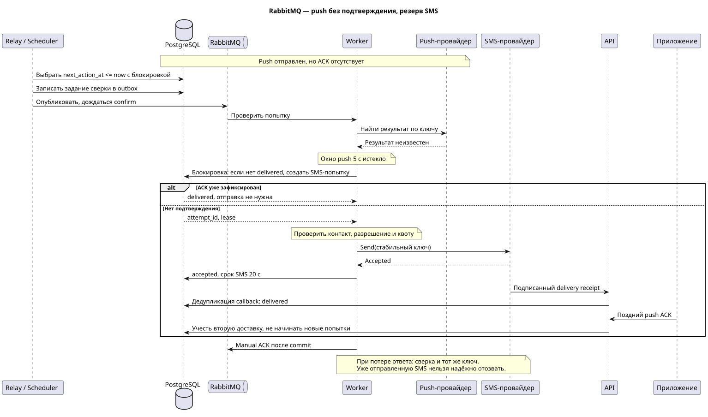
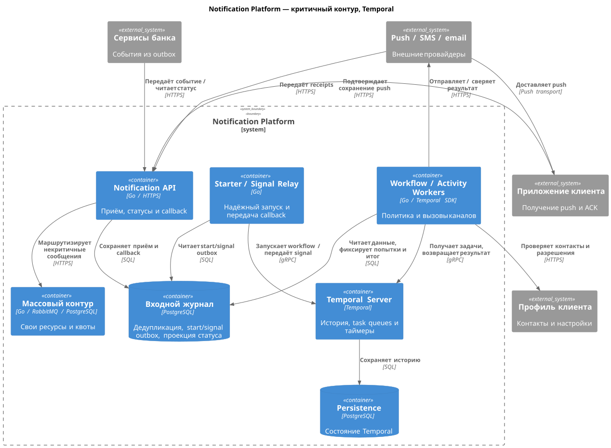
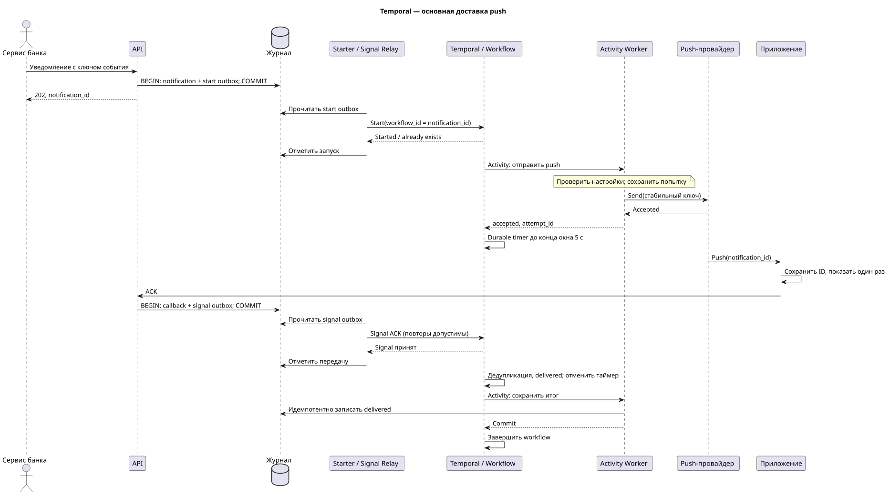
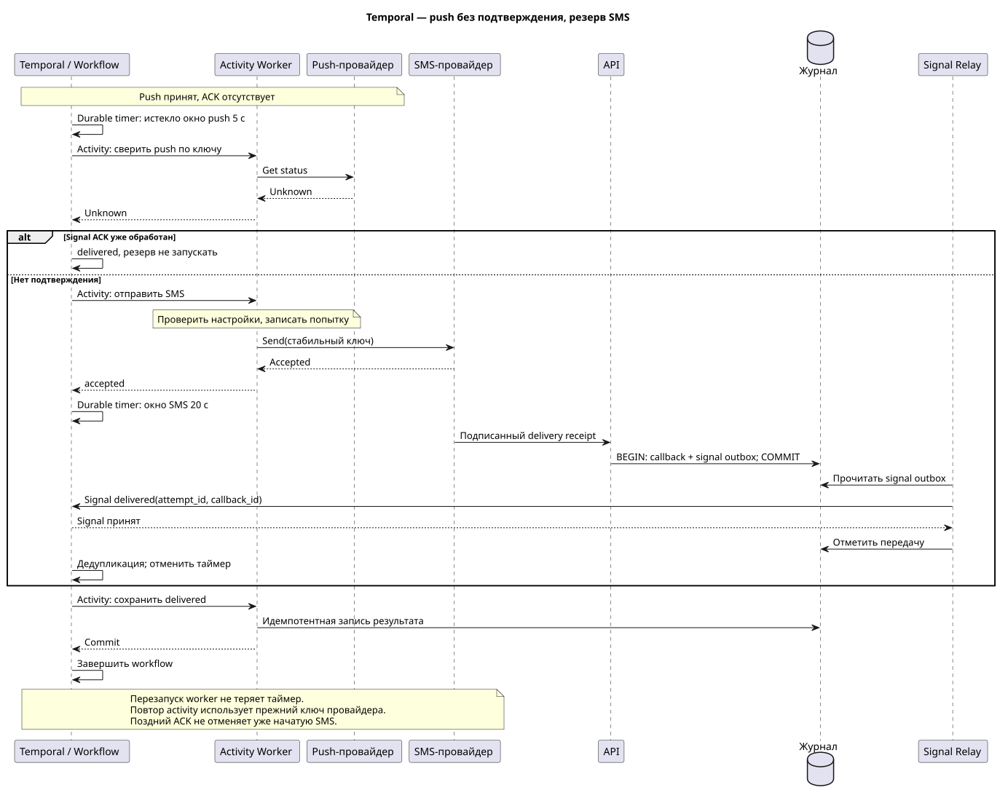

# RFC: гарантированная доставка критичных уведомлений

| Метаданные | Значение |
| --- | --- |
| **Статус** | DRAFT |
| **Автор(ы)** | Кардашевский Илья Николаевич |
| **Ответственный** | Не назначен |
| **Бизнес-заказчик** | Онлайн-банк |
| **Ревьюеры** | Ревью не проводилось |
| **Дата создания** | 2026-11-16 |
| **Дата обновления** | 2026-11-17 |

## Оглавление

1. [Контекст](#контекст)
2. [Продуктовый анализ](#продуктовый-анализ)
3. [Пользовательские сценарии](#пользовательские-сценарии)
4. [Статистика](#статистика)
5. [Требования](#требования)
6. [Варианты решения](#варианты-решения)
7. [Сравнительный анализ](#сравнительный-анализ)
8. [Выводы](#выводы)
9. [Связанные задачи](#связанные-задачи)
10. [Приложения](#приложения)

## Контекст

Сейчас команды банка отправляют сообщения независимо. Общая платформа должна сохранять принятое уведомление, доводить его до подтверждения хотя бы в одном канале и автоматически переключать канал при отказе.

Цели: первая попытка p99 $\le$ 1 с, 99,9% подтверждений за 60 с, сохранность сообщений при отказе зоны.

Вне RFC: редактор шаблонов, сегментация аудитории и алгоритм рекомендаций.

### Ключевые вопросы

Как не потерять принятое сообщение, когда переключать канал и как ограничить дубли при неизвестном результате?

## Продуктовый анализ

Для клиента важны своевременное подтверждение операции и отсутствие лишних сообщений. Поддержке нужен единый статус доставки, командам банка - общий способ отправки.

Цели: рост D30 retention на 15% и снижение жалоб на 1 000 доставленных сообщений на 30%. Проверяем за восемь недель против контрольной группы. В эксперименте меняем сервисные и маркетинговые сценарии, критичные сообщения получают обе группы.

Транзакционные сообщения обязательны, основной канал выбирает пользователь. Сервисные отключаются по категориям. Маркетинг требует согласия и ограничен одним сообщением в сутки и тремя в неделю. Пять сообщений из условия считаем предложениями до фильтрации.

## Пользовательские сценарии

| Приоритет | Тип сценария | Действующее лицо | Сценарий |
| --- | --- | --- | --- |
| MUST HAVE | Основной | Клиент банка | После перевода получает одно уведомление по выбранному доступному каналу. |
| MUST HAVE | Отказ | Клиент банка | При недоступности push получает сообщение через SMS, затем при необходимости email. |
| MUST HAVE | Настройки | Клиент банка | Меняет основной канал, отключает категории сервисных сообщений или отзывает согласие на маркетинг. |
| MUST HAVE | Повтор запроса | Сервис банка | Повторно передаёт событие после сетевой ошибки и получает прежний ID уведомления. |
| MUST HAVE | Недоставка | Поддержка | Видит неподтверждённое сообщение и причины отказов, проверяет контакт и возобновляет доставку с тем же ID. |
| SHOULD HAVE | Контроль расходов | Команда уведомлений | Сравнивает стоимость каналов и долю failover, корректирует политику без ухудшения критичных SLO. |

MUST HAVE - обязательно для запуска, SHOULD HAVE - желательно.

## Статистика

MAU - 10 млн, DAU - 3 млн, одновременно активны до 300 тыс. пользователей. В день на пользователя: 2 транзакционных, 3 сервисных и 5 маркетинговых уведомлений. Кампания - до 1 млн получателей. Пик и доли успешных отправок ниже приняты как допущения.

## Требования

Обозначения F, N и A соответствуют [требованиям платформы](../README.md). Окно SLO - календарный месяц.

### Функциональные требования

| N | Приоритет | Обозначение | Требование |
| --- | --- | --- | --- |
| 1 | MUST HAVE | F1 | Сервисы банка передают уведомления через единую платформу и получают их итоговый статус. |
| 2 | MUST HAVE | F2 | При отказе основного канала критичное сообщение отправляется через резервный. Недоставка видна поддержке. |
| 3 | MUST HAVE | F3 | Пользователь выбирает основной канал, отключает категории сервисных сообщений и отзывает согласие на маркетинг. Критичные сообщения не отключаются. |
| 4 | MUST HAVE | F4 | Повтор события возвращает прежнее уведомление. Подтверждение доставки отменяет ещё не начатые отправки. |
| 5 | MUST HAVE | F5 | Команда запускает, планирует и отменяет кампанию до 1 млн получателей. Кампания не задерживает сообщения о деньгах. |
| 6 | MUST HAVE | F6 | Маркетинг приходит с 09:00 до 21:00 по времени пользователя, не чаще одного сообщения в сутки и трёх в неделю. При неизвестном часовом поясе отправка откладывается. |
| 7 | MUST HAVE | F7 | Поддержка видит попытки и причины недоставки. Команда кампании видит статистику доставки, отказов и отписок. |

### Нефункциональные требования

| N | Приоритет | Обозначение | Требование |
| --- | --- | --- | --- |
| 1 | MUST HAVE | N1 | Доступность приёма 99,95%, p99 ответа <= 200 мс. Для критичных сообщений p99 от приёма до первой попытки <= 1 с. Подтверждение: 99% за 5 с, 99,9% за 60 с, включая внешние отказы. |
| 2 | MUST HAVE | N2 | Обработка 4 000 уведомлений/с, из них 700 критичных/с. Пик 10 000/с в течение минуты. Кампания на 1 млн обрабатывается за 30 минут, включая фильтрацию, с сохранением N1. |
| 3 | MUST HAVE | N3 | Отказ узла или зоны: RPO = 0 для принятых сообщений, RTO <= 5 минут. Неизвестные результаты сохраняются до сверки. Потеря региона: RPO <= 5 минут, RTO <= 1 часа. |
| 4 | MUST HAVE | N4 | Ключ запроса исключает повторную запись в течение 30 суток. Тест с 10% повторных запросов и callback не создаёт новых уведомлений. SLO межканальных дублей: <= 0,1% критичных сообщений за месяц. |
| 5 | MUST HAVE | N5 | Отзыв согласия применяется за 5 с. При недоступных настройках маркетинг ждёт. Все внешние вызовы используют TLS, доступ к контактам ограничен ролями. Тексты и контакты не попадают в логи и метрики. |
| 6 | MUST HAVE | N6 | Статус и попытки всех сообщений хранятся 30 суток. Через 60 с без подтверждения критичного сообщения поддержка получает сигнал. Массовый отказ обнаруживается за минуту. |
| 7 | SHOULD HAVE | N7 | При доступном push и устройстве >= 95% критичных сообщений с основным push обходятся без SMS. Стоимость 1 000 доставок по каналам измеряется ежедневно. |

### Архитектурно значимые требования

P0 - обязательно для запуска, P1 - после P0.

| ASR | Приоритет, требования | Почему влияет на архитектуру и последствия |
| --- | --- | --- |
| A1. Короткая задержка при массовых рассылках | P0, F2, F5, N1, N2 | Кампания задерживает общую очередь. Нужны отдельные ресурсы критичного потока и лимиты рассылок. |
| A2. Восстановимая доставка с failover | P0, F2, N3, N6 | Сбой может скрыть результат отправки. Нужны журнал состояния, таймеры, резервные каналы и сверка. |
| A3. Повторы без нового уведомления | P0, F4, N4 | Повторы возможны на каждом этапе. Нужны стабильные ключи, атомарные переходы и дедупликация callback. |
| A4. Настройки и защита данных | P0, F3, F6, N5 | Отправка зависит от согласия и категории. Нужны проверка разрешений, разделение прав и срок хранения контактов. |
| A5. Контролируемая стоимость и наблюдаемость | P1, F7, N6, N7 | Повторы увеличивают расходы. Нужны последовательный выбор каналов и учёт стоимости, результатов и задержек. |

### Расчёт нагрузок

Расчёт ведём по 3 млн DAU. Отдельно оцениваем профиль по 10 млн MAU. Постоянные соединения с платформой не нужны, push ACK приходит HTTP-запросом.

| Тип | В сутки по DAU | Среднее в секунду | Пик *10 |
| --- | ---: | ---: | ---: |
| Транзакционные | 6 млн | 69 | 694 |
| Сервисные | 9 млн | 104 | 1 042 |
| Маркетинговые, до фильтров | 15 млн | 174 | 1 736 |
| Всего | 30 млн | 347 | 3 472 |

Кампания на 1 млн за 30 минут добавляет 556 заданий/с. Вместе с пиком получаем 4 028/с, округляем до 4 100/с. Коэффициент пика *10 нужно проверить по событиям банка. Расчёт по MAU даёт 100 млн/сутки, в среднем 1 157/с и 12 130/с с пиком и кампанией. Этот профиль требует дополнительной ёмкости.

При 95% успешных push понадобится 300 тыс. SMS/сутки. Если 98% SMS доставлены, остаётся 6 тыс. email/сутки. Расчёт предполагает основной push у всех пользователей. Стоимость: `300 000 * цена SMS + 6 000 * цена email + push и инфраструктура`. При полном отказе push расход SMS вырастет в 20 раз, до 6 млн/сутки. Цены берём из договоров.

Для критичного пика нужна суммарная квота SMS от 700/с. При задержке 200 мс это 140 одновременных вызовов, с двукратным запасом - 280. Проход по трём каналам даёт до 2 100 попыток/с плюс повторы и callback. Если минутный пик 10 000/с целиком критичный, для соблюдения SLO нужна соответствующая квота провайдеров.

При 2 КБ на уведомление с попытками: 60 ГБ/сутки и 1,8 ТБ за 30 суток. С индексами и запасом *2 - 3,6 ТБ на копию, три копии - 10,8 ТБ без WAL и backup. Критичный поток занимает 12 ГБ/сутки, или 360 ГБ/месяц без индексов. Историю делим по суткам и удаляем по сроку. Час простоя при 4 100/с оставит 14,76 млн заданий, около 7,4 ГБ при 500 байтах на задание без накладных расходов брокера.

### Гарантии и ограничения

Платформа подтверждает приём после устойчивого сохранения. При отказе кворума источник сохраняет событие и повторяет запрос. Целевое p99 от банковского события до приёма - <= 1 с при доступной платформе.

`delivered` требует ACK приложения после сохранения push, SMS receipt оператора или подтверждения почтового сервера. Email может попасть в спам. Ответ API провайдера даёт статус `accepted`, отсутствие подтверждения - `unknown`.

Принятые сообщения сохраняются, обработка возобновляется после сбоя. Для доставки нужен хотя бы один доступный канал с действительным контактом. Через 60 с без подтверждения фиксируем нарушение SLO. Через 24 часа останавливаем автоматические отправки и ставим `needs_attention`. Поддержка проверяет контакт и может продолжить доставку с тем же ID.

При потерянном ACK запускаем резерв с риском повтора. Входной ключ исключает повторную запись уведомления. Межканальные повторы учитываются отдельно.

## Варианты решения

### Общий контракт и политика доставки

Источник передаёт `source`, `event_id`, `recipient_id`, категорию, версию шаблона и параметры. Ключ `(source, event_id, recipient_id, category)` хранится 30 суток. Повтор возвращает прежний `notification_id`, другой payload с тем же ключом вызывает конфликт. Более старые события повторяет только оператор после проверки.

Журнал хранит ключ, состояние, версию политики, сроки и текущую попытку. У попытки есть ID, канал, провайдер, ключ отправки, статус, время и ошибка. ID callback уникален для провайдера. Контакты берём из профиля банка, смена контакта требует проверки владельца.

Порядок: push -> SMS -> email. Предпочтительный канал ставим первым, недоступные каналы пропускаем. При неизвестных настройках критичные сообщения идут по стандартному порядку на подтверждённые контакты, маркетинг ждёт. Перед отправкой проверяем разрешения с кешем до 5 с. Если кеш истёк, а настройки недоступны, маркетинг блокируется. Уже отправленное сообщение отозвать надёжно нельзя.

HTTP-таймаут - 1 с. Окна от начала попытки: push - 5 с, SMS - 20 с, email - 30 с, включая вызовы и ожидание receipt. При явном отказе сразу переключаем канал. При неизвестном результате сверяем статус по ключу, по истечении окна запускаем резерв. Проход по трём каналам занимает до 55 с плюс внутренние задержки.

В пределах окна делаем до двух вызовов с одним ключом. На 429 ждём `Retry-After`, если он помещается в окно, иначе выбираем резерв. Ошибка адреса останавливает повторы до его исправления. После неудачи всех каналов сверяем статусы и повторяем через 1, 5, 15 минут, затем раз в час с jitter до 24 часов. Новый ключ создаём только после подтверждённого окончательного отказа. Провайдер должен хранить ключи весь цикл.

Circuit breaker провайдера открывается на 15 с при >= 50% ошибок из минимум 20 вызовов за 30 с, затем пропускает пробный запрос. Реплики делят общую квоту с резервом для критичных сообщений. Превышение бюджета останавливает маркетинг и вызывает сигнал дежурному.

### Вариант 1: PostgreSQL, RabbitMQ и автомат доставки

Состояние и сроки хранятся в PostgreSQL, RabbitMQ передаёт задания обработчикам.

#### Архитектура

API и обработчики написаны на Go. Критичный и массовый потоки используют отдельные PostgreSQL, RabbitMQ, пулы обработчиков и квоты. RabbitMQ хранит quorum queues на трёх узлах в разных зонах. PostgreSQL имеет primary и две реплики, commit подтверждает хотя бы одна реплика. Patroni с etcd переключает запись на реплику с подтверждённым WAL и изолирует старый primary.

[PlantUML](rabbit-containers.puml). Показан критичный контур. Массовый контур использует тот же API и отдельные ресурсы.

API сохраняет уведомление и outbox одной транзакцией, затем возвращает `202`. Relay публикует задание с `mandatory` и отмечает отправку после publisher confirm. Потребитель делает manual ACK после записи результата в БД. Повторная публикация обрабатывается идемпотентно. Подробности: [RabbitMQ confirms](https://www.rabbitmq.com/docs/confirms), [quorum queues](https://www.rabbitmq.com/docs/quorum-queues).

Обработчик блокирует запись, проверяет версию и создаёт попытку с lease. Сетевой вызов выполняется вне транзакции. Планировщик выбирает просроченные задачи по индексу `next_action_at` через `FOR UPDATE SKIP LOCKED`, меняет срок и пишет outbox одной транзакцией. Истёкший lease запускает сверку. Проверка версии защищает состояние от старого обработчика, ключ провайдера - от повторного вызова.

#### Основной сценарий

[PlantUML](rabbit-main.puml). Push ACK и callback провайдера проходят через API, который проверяет подпись/авторизацию, принадлежность попытке и допустимость перехода.

#### Failover

[PlantUML](rabbit-failover.puml). ACK и таймер блокируют одну запись. ACK до создания SMS-попытки отменяет её. После начала отправки возможен повтор.

Состояния уведомления: `pending -> delivering -> delivered` или `delivering -> needs_attention`. Подтверждение любой попытки завершает доставку, поздняя ошибка её не отменяет. Статусы попытки: `prepared`, `accepted`, `unknown`, `delivered`, `failed`. Планировщик восстанавливает задания из БД. Невалидные задания попадают в очередь ошибок с сигналом дежурному.

#### Этапы реализации

| Этап | Описание | Планируемый срок | Ресурсы | Риски |
| --- | --- | --- | --- | --- |
| 1 | Контракт, входной журнал, outbox, выделенные БД и очереди | Недели 1-2 | 2 backend-разработчика, SRE | Ошибки при переключении БД и дедупликации |
| 2 | Адаптеры каналов, автомат, таймеры, callback, метрики | Недели 3-4 | 2 backend-разработчика, QA | Неоднозначные статусы и квоты провайдеров |
| 3 | Проверки нагрузки и отказов, теневой режим и пилот | Недели 5-6 | Backend, QA, SRE | Гонки ACK и failover, превышение SLO дублей |

#### Преимущества

- Состояние и срок меняются одной транзакцией. Поддержка читает готовый журнал.
- Небольшой набор технологий, RabbitMQ также обслуживает отдельный массовый контур.

#### Недостатки

- Таймеры, lease и восстановление зависших попыток нужно реализовать самостоятельно.
- Нужно проверять гонки callback и отправки.

### Вариант 2: Temporal

Workflow управляет порядком каналов и таймерами, activities выполняют отправку и сверку.

#### Архитектура

API и workers используют Go и Temporal SDK. Temporal Server хранит историю в отдельной PostgreSQL с синхронными репликами по зонам. Другая PostgreSQL хранит входной журнал и ключи дедупликации. Массовая отправка работает отдельно на RabbitMQ и своих БД.

[PlantUML](temporal-containers.puml).

API сохраняет уведомление и start outbox одной транзакцией. Starter запускает workflow с ID уведомления, повторное использование завершённого ID запрещено. Входной журнал хранит ключи 30 суток независимо от срока истории Temporal. Workflow управляет каналами и таймерами. Activities вызывают провайдеров, их повторы ограничены окнами доставки.

Callback API сохраняет событие и signal outbox одной транзакцией. Relay передаёт signal до подтверждения Temporal. Workflow отсеивает повторные callback и перед завершением записывает итог в журнал через идемпотентную activity. При сбое БД activity повторяется. Состоянием доставки управляет workflow, API читает его копию из журнала.

Поздний callback завершённого workflow сохраняется для учёта дублей. Relay проверяет итог и закрывает задание. Подтверждение для `needs_attention` меняет статус на доставленный и закрывает задачу поддержки.

#### Основной сценарий

[PlantUML](temporal-main.puml).

#### Failover

[PlantUML](temporal-failover.puml). Таймер переживает остановку worker. Повтор activity использует прежний ключ провайдера, см. [идемпотентность activities](https://docs.temporal.io/activity-definition).

#### Этапы реализации

| Этап | Описание | Планируемый срок | Ресурсы | Риски |
| --- | --- | --- | --- | --- |
| 1 | Развернуть Temporal, настроить persistence и проверить восстановление | Недели 1-2 | SRE, backend-разработчик | Недостаток опыта эксплуатации Temporal |
| 2 | Входной журнал, workflow, activities, start/signal outbox и адаптеры | Недели 3-5 | 2 backend-разработчика, QA | Повторные activities, рассогласование проекции статуса |
| 3 | Тесты нагрузки, replay при обновлении, теневой режим и пилот | Недели 6-7 | Backend, QA, SRE | Объём истории и несовместимые изменения workflow |

#### Преимущества

- Таймеры и восстановление исполнения предоставляет Temporal.
- История workflow упрощает разбор длительных и разветвлённых сценариев.

#### Недостатки

- Нужны отдельная инфраструктура, навыки сопровождения и правила обновления workflow.
- Дополнительные расходы на историю workflow.

### Общие меры при отказах и защита данных

| Ситуация | Действие |
| --- | --- |
| Провайдер принял сообщение, ответ потерян | `unknown`, поиск по ключу, повтор только с тем же ключом. При истечении окна - резерв с учётом риска дубликата. |
| Callback повторился или пришёл не по порядку | Уникальный ID события и проверка состояния. Успех не заменяется поздней ошибкой. |
| Поздний push ACK после запуска SMS | Завершить уведомление, отменить ещё не начатые попытки. Начатая SMS может дойти. Зафиксировать межканальный повтор. |
| Отказ зоны или брокера | Сохранённые задачи остаются в БД, обработка возобновляется после переключения, N1 может нарушиться в пределах RTO. |
| Недоступны все каналы | Сверка и ограниченные повторы, сигнал через 60 с, задача поддержки через 24 часа. |
| Регион потерян | Восстановление из межрегиональной копии и replay outbox источников. Последние 5 минут не покрыты нулевым RPO. Перед replay сверяем ключи с провайдерами. |

Push-клиент отсеивает повторы по `notification_id`. Общей дедупликации между push, SMS и email нет.

Права API ограничены категориями и шаблонами. Маркетинговой команде запрещена транзакционная категория. Настройки меняет только владелец. Callback проверяется по подписи, времени и ID, push ACK - по сессии и владельцу уведомления. Контакты шифруются, полные реквизиты в текст не попадают. История хранится 30 суток, тело удаляется в течение 24 часов после доставки. Задача поддержки хранит ID события и причину.

### Наблюдаемость

OpenTelemetry связывает событие и попытки. Prometheus и Grafana показывают задержки, возраст очереди, `unknown`, failover, дубли, ошибки провайдеров и расходы. ID хранятся в трассах и журнале. Потерянные receipts могут занижать измеренную долю дублей.

Через 60 с без подтверждения создаётся запись для поддержки. Дежурный получает сигнал, если таких сообщений > 1% за 5 минут или при наличии трафика минуту нет успешных доставок. Журнал сохраняет все попытки независимо от sampling трасс.

## Сравнительный анализ

### Ресурсные требования

Сроки предварительные, при готовом API профиля и доступах к провайдерам. Команда: два backend-разработчика, QA и SRE с частичной занятостью.

| Критерий | Вариант 1 | Вариант 2 |
| --- | --- | --- |
| Время реализации | 6 недель | 7 недель |
| Команда | 2 backend, QA и SRE | Тот же состав. Нужен опыт Temporal |
| Инфраструктура критичного контура | Go API и workers, PostgreSQL с двумя репликами, 3 узла RabbitMQ, Patroni/etcd | Go API и workers, Temporal Server, отдельные PostgreSQL для журнала и persistence с репликацией |
| Организационные риски | Поддержка собственного автомата и таймеров | Освоение Temporal и сопровождение совместимых версий workflow |

Обоим вариантам нужны массовый контур и мониторинг. CPU, RAM и число workers подбираем нагрузочным тестом.

### Соответствие требованиям

| Требование | Вариант 1 | Вариант 2 |
| --- | --- | --- |
| F1, F4 | Единый API, уникальный ключ, атомарные переходы | Единый API, входной ключ, workflow ID |
| F2 | Журнал состояний и резервные каналы | Workflow, timers и activities каналов |
| F3, F6 | Проверка настроек и лимитов перед вызовом | Та же проверка в activities и массовом контуре |
| F5 | Отдельный массовый контур | Такой же отдельный массовый контур |
| F7, N6 | Журнал попыток, метрики и сигналы | Журнал, история workflow, метрики и сигналы |
| N1, N2 | Выделенные ресурсы и квоты, SLO требуют нагрузочного теста | Изоляция workflow и workers, SLO требуют нагрузочного теста |
| N3 | Репликация БД и брокера, outbox, планировщик | Репликация журнала и persistence, восстановление workflow |
| N4 | Входной ключ, ключ провайдера, дедупликация callback | Те же ключи, дедупликация signals |
| N5 | Авторизация, TLS, проверка настроек, сроки хранения | Те же меры, только ID в истории workflow |
| N7 | Последовательные каналы и учёт стоимости | Та же политика, проверка доли SMS на пилоте |

### Соответствие ASR

| ASR | PostgreSQL + RabbitMQ | Temporal |
| --- | --- | --- |
| A1, P0 | Независимые критичные очереди, БД, обработчики и квоты. Масштабирование по возрасту очереди. | Отдельный критичный кластер и task queues по каналам. Масштабирование workers по schedule-to-start latency. |
| A2, P0 | Outbox, журнал попыток, lease и сохраняемые сроки. Планировщик восстанавливает задачи. | История workflow и durable timers восстанавливают оркестрацию, activities сверяют внешний результат. |
| A3, P0 | Уникальный входной ключ, версия записи, дедупликация callback и ключ провайдера. | Уникальный workflow ID, входной журнал, дедупликация signals и тот же ключ провайдера. |
| A4, P0 | Проверка настроек перед отправкой, TLS, сервисные роли, зашифрованные контакты. | Те же проверки в activities. В историю workflow передаются ID, без контактов и тела сообщения. |
| A5, P1 | Последовательные попытки, журнал стоимости, метрики и трассы по ID. | Та же политика каналов и метрик, дополнительно история workflow для разбора. |

SLO проверяем нагрузкой и отказами.

## Выводы

Выбран вариант 1: для трёх каналов достаточно небольшого автомата, RabbitMQ уже нужен массовому контуру. Состояние и срок следующей попытки меняются одной транзакцией. Основные затраты - реализация и проверка таймеров, lease и гонок callback.

Temporal стоит рассмотреть при появлении сложных длительных процессов. Он требует отдельной эксплуатации и совместимости версий workflow. При 6 млн workflow/сутки и 20 событиях по 1 КБ история добавит около 120 ГБ/сутки без индексов и реплик. Для текущего сценария эти расходы не оправданы.

### Проверка и внедрение

Сначала проверяем один тип события в теневом режиме. Затем включаем отправку для 1%, 10% и 100% пользователей. В каждой группе работает один отправитель. При откате новые события получает старая система, принятые завершает платформа.

Проверяем 4 100 заданий/с с кампанией, минутный пик 10 000/с и профиль MAU. В тестах отключаем push, теряем ответы SMS, дублируем callback, останавливаем worker после вызова и выводим зону. Проверяем N1-N7 и восстановление принятых ID. При входящих 4 100/с и обработке 8 200/с часовой backlog уйдёт за час. Такая скорость требует запаса квот провайдеров.

Если пилот превышает 0,1% межканальных повторов, нужно увеличить окно ожидания или пересмотреть SLO дублей.

## Связанные задачи

Перед внедрением:

| Задача | Результат | Зависимость |
| --- | --- | --- |
| Проверить провайдеров | Подтверждённые квоты, receipts, поиск по ключу и срок идемпотентности | F2, N1, N4 |
| Согласовать политику | Правила обязательных резервных каналов, контактов и хранения | F3, N5 |
| Измерить push ACK | Распределение задержек по ОС и операторам, уточнённые окна failover | N1, N4, N7 |
| Проверить нагрузку и восстановление | Результаты базового профиля, MAU-профиля и отказа зоны | N1-N3 |

## Приложения

### Глоссарий

| Термин | Определение |
| --- | --- |
| ACK / receipt | Подтверждение получения. Его смысл зависит от канала. |
| Failover | Переключение на резервный канал после отказа или истечения окна ожидания. |
| Outbox | Запись задания в одной транзакции с данными для последующей отправки. |
| Lease | Ограниченное по времени право обработчика выполнять попытку. |
| SLO | Целевой уровень качества, проверяемый по метрикам за заданное окно. |
| RPO / RTO | Допустимая потеря данных во времени / время восстановления. |
| Workflow / activity | Сохраняемый процесс Temporal / операция, выполняющая внешний вызов или другую работу. |
